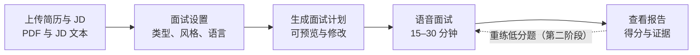
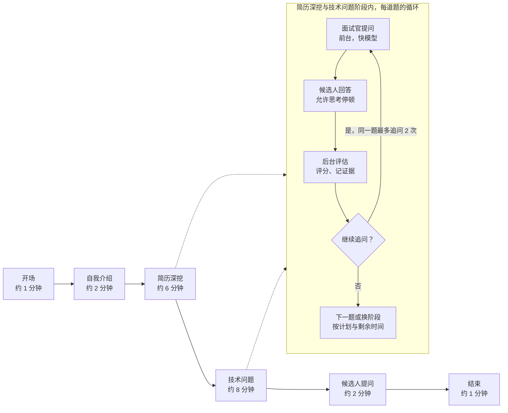
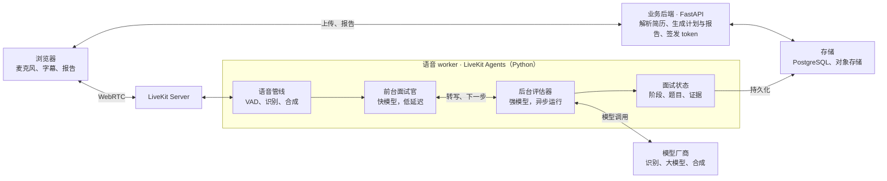
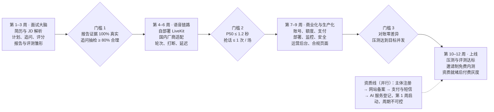

# 语音模拟面试 Agent PRD 与技术方案（商业版 v1）

> 本文件导出自在线文档（2026-10-13），在线版可编辑、可批注：https://claude.ai/code/artifact/aa52a5a6-f351-4da7-97bb-530e3fb6e2f3

Oct 13, 2026 · @annewong

## 背景与目标

面向国内求职者的付费语音模拟面试产品：用户上传简历和 JD，和 AI 面试官进行 15–30 分钟的语音面试，结束后拿到带证据的评估报告。v1 由一人在 2–3 个月内上线，功能范围小，但账号、计费、稳定性、安全、合规、监控全部按生产标准实现。

**为什么做**

- 求职者缺少低成本、随时可用、贴近真实的面试练习：文字题库练不到口头表达和应对追问，真人陪练一小时价格高、需要预约。
- 语音 + 追问 + 证据式报告是差异点：只做题库或文字对话的产品替代不了。

**成功指标（v1 上线后 3 个月，建议值）**

| 类别 | 指标 | 口径 | 目标 |
| --- | --- | --- | --- |
| 体验 | 端到端延迟 P50 / P95 | 候选人说完到听到面试官首个字 | ≤ 1.2 s / ≤ 2.0 s |
| 体验 | 抢话次数 | 候选人思考时被打断的次数 / 场 | ≤ 1 |
| 质量 | 报告有用率 | 用户评价“有帮助”的比例 | ≥ 70% |
| 增长 | 注册后完成首场面试率 | 注册 7 天内完成第一场并看到报告 | ≥ 50% |
| 商业 | 免费转付费率 | 完成免费场后 30 天内付费 | ≥ 5% |
| 商业 | 毛利率 | （收入 − 模型与云成本）/ 收入 | ≥ 60% |
| 商业 | 次月续费率 | 订阅用户第二个月续费 | ≥ 40% |
| 稳定 | 服务可用性 | 按月统计，含语音和支付 | ≥ 99.5% |
| 稳定 | 面试中途失败率 | 因系统原因无法完成的场次 | ≤ 2% |
| 资金 | 重复扣费、漏发额度 | 对账结果 | 0 |

## 目标用户与核心场景

v1 只服务自己练习的求职者，优先覆盖技术岗（后端、AI 应用、voice agent 方向）。

| 用户 | 诉求 | v1 是否覆盖 |
| --- | --- | --- |
| 准备跳槽的工程师 | 针对具体岗位练习，知道自己哪里答得不好 | 是 |
| 校招应届生 | 练习自我介绍和项目描述，缓解紧张 | 是 |
| 投海外岗位的人 | 练习英文面试 | 是（中英文两种语言） |
| 企业 HR | 用 AI 初筛候选人 | 否（合规负担重，暂不做） |

**典型场景**

1. 用户收到某公司面试邀请，粘贴对方 JD，上传简历，选“技术一面、温和、中文、20 分钟”，开始模拟。
2. 面试官从自我介绍开始，抓住简历里的项目追问细节，再问与 JD 相关的技术题，最后留时间让候选人提问。
3. 候选人回答时停下来思考，面试官不抢话；候选人说“能再说一遍题目吗”，面试官重复。
4. 结束后用户查看报告：哪些能力项得分低、引用了哪句原话、更好的回答应该怎么说；针对低分题重新练一次。

**用户故事**

1. 作为候选人，我想让面试官根据我的简历和目标 JD 提问，而不是通用题库。
2. 作为候选人，我想要一个会追问的面试官，类似真人面试的压力。
3. 作为候选人，我想在思考时不被打断，也想随时打断面试官问清楰题目。
4. 作为候选人，我想看到每个结论对应的我的原话，以及具体的改进建议。
5. 作为候选人，我想看到多次练习之间的进步。

## 范围

v1 做“一场完整的语音面试 + 报告”的付费闭环；只要上线收费就必须有的能力（账号、计费、合规、运维、客服）全部进 v1，可以延后的体验功能放 v2。

| v1（上线收费） | v2 | 不做 |
| --- | --- | --- |
| 手机号验证码登录 | 微信登录（需主体认证） | 企业初筛、候选人管理 |
| 免费试用 + 月度订阅 + 按次加购，微信支付与支付宝 | 机构版（高校、培训机构） | 视频表情分析、声纹 |
| 网页上传简历（PDF）与粘贴 JD | 从招聘链接抓取 JD | 电话渠道 |
| 技术面、行为面；温和、压力；中文、英文 | 系统设计面（白板）、代码题（编辑区） | 原生 App |
| 双层 agent：前台面试官 + 后台评估器 | 自定义面试官人设、按公司定制题库 |  |
| 报告：得分、证据、改进建议、转写、录音 | 历史对比、进步曲线、低分题重练 |  |
| 模拟候选人评测接入发布流程 | 自动化 A/B 实验 |  |
| 生产部署、监控告警、备份、灰度发布 | 多地域部署 |  |
| 内容安全审核、AI 生成内容标识、用户协议与隐私政策 |  |  |
| 运营后台：用户、订单、退款、用量、工单 | 运营数据大盘 |  |
| 桌面浏览器 + 微信内置浏览器 + 手机浏览器 | 微信小程序 |  |

## v0 个人版（先行）

先做一个只给自己用、跑在本机的版本，把面试体验打磨好；v1 商业版在 v0 的代码上增量开发。全职约 4–5 周，下班后兼职约 2–3 个月。

| 保留（核心价值） | 暂缓到 v1 |
| --- | --- |
| 简历与 JD 解析、面试计划、追问、评分、报告 | 手机号登录、支付、额度计费 |
| 语音面试：LiveKit Agents、轮次、打断、过渡话术 | 用户中心、运营后台 |
| 双层 agent：前台面试官 + 后台评估器 | 备案、商户、AI 服务登记等资质 |
| 模拟候选人评测集 | Kubernetes、多可用区、WAF、内容安全审核 |
| 每轮延迟与抢话埋点 | 监控告警、值班手册 |
| 历史记录、录音回放 | 微信内置浏览器适配 |

**运行方式**：本机 Docker Compose，包含 LiveKit Server（开发模式）、语音 worker、FastAPI、PostgreSQL；浏览器访问 localhost。不对外公开，不涉及备案和收费资质。

**为 v1 预留**

- 数据表从一开始带 user\_id。
- 识别、合成、大模型都走统一的厂商适配层，靠配置切换。
- 提示词带版本号，每场面试记录使用的版本。
- 结构化日志 + trace ID，延迟按环节记录。
- 单元测试齐全，评测集一条命令跑完。
- 配置与密钥全部走环境变量。

**v0 里程碑**

| 阶段 | 内容 | 全职 | 兼职 | 完成标准 |
| --- | --- | --- | --- | --- |
| 1 | 文字版面试大脑 + 评测集雏形 | 1.5–2 周 | 3–4 周 | 文字面试能完整走完；报告证据 100% 真实 |
| 2 | 接入语音：LiveKit Agents、轮次、打断 | 1.5–2 周 | 3–4 周 | P50 ≤ 1.2 s；抢话 ≤ 1 次 / 场 |
| 3 | 报告页、历史记录、延迟埋点、体验打磨 | 1 周 | 2 周 | 自己完成 10 场真实练习并觉得有用 |

## 商业模式与定价

按“面试分钟数”卖：成本主要随分钟数增长，定价单位和成本单位一致才能保住毛利。具体价格在成本测算后确定（见成本模型）。

| 套餐 | 内容 | 定价原则 |
| --- | --- | --- |
| 免费试用 | 每个手机号 1 场 10 分钟，完整报告 | 获客成本，配合防薅策略 |
| 月度订阅 | 每月含固定分钟数（如 120 分钟，待定），含历史对比等 v2 功能 | 毛利 ≥ 60%，单分钟价格低于加购 |
| 按次加购 | 单场或分钟包（如 30 / 60 分钟），有效期 90 天 | 单价高于订阅，引导订阅 |

**规则**

- 计费口径：以面试实际进行的时长计量，按秒累计、向上取整到分钟；因系统原因中断的时长不计费并自动返还。
- 扣减顺序：先扣订阅当月额度，再扣加购包（按到期日从早到晚）。
- 余额不足：开始前提示；面试中剩余 2 分钟时提示，用完后面试官收尾并生成报告。
- 订阅续费：v1 采用按月购买、到期前提醒续费；自动续费（周期扣款）在取得相应支付能力后再开启，并须明示、可随时取消。
- 退款：未使用的加购包 7 天内可申请退款；已使用部分不退；系统故障导致的损失按分钟返还。具体条款写入用户协议。

## 账号、计费与支付

额度是钱：账本、支付回调和扣减都按金融级标准做，一笔不重、一笔不漏、每天对账。

### 账号

- 手机号 + 短信验证码登录（短信签名通常需要主体资质，列入上线前置事项）；验证码限频（同一号码 60 秒 1 次、每天 10 次）、图形或滑块验证防刷。
- 会话：短有效期 access token + 可吊销的 refresh token；支持登出全部设备。
- 注销账号：删除简历、录音、转写与报告；订单记录按财务要求保留。
- 未成年人：注册时确认年满 18 周岁（产品面向求职成年人）。

### 额度记账

- 采用只增不改的额度流水表：发放（订阅、加购、赠送、故障返还）和扣减（面试消耗）各一条记录，余额 = 流水之和。
- 面试开始时预占额度（按设定时长），结束时按实际时长结算并释放多占部分；worker 崩溃时由定时任务按最后心跳结算。
- 每一条流水带业务幂等键（如订单号、面试 ID），重复写入无效。

### 支付

- 渠道：微信支付（电脑端扫码、微信内置浏览器内支付、手机浏览器 H5）与支付宝（电脑网站与手机网站支付）。商户号需要个体工商户或公司主体。
- 下单：服务端生成订单号并先落库，金额只从服务端商品表读取，不信任前端。
- 回调：验签 → 校验金额与订单号 → 在同一事务中更新订单状态并发放额度（幂等）→ 返回成功；回调未到时定时主动查单。
- 退款：运营后台发起，扣回对应未用额度后再调渠道退款，退款单号幂等，结果以渠道回调或查询为准。
- 对账：每天下载渠道账单，和订单表、额度流水逐笔核对，差异告警。
- 发票：用户在订单页申请，v1 人工开具电子普票，量大后接开票服务。

### 数据模型（新增）

| 实体 | 主要字段 |
| --- | --- |
| product | id, type（subscription / pack / trial）, minutes, price\_cents, validity\_days, active |
| order | id, user\_id, product\_id, amount\_cents, channel, status, channel\_txn\_id, paid\_at, idempotency\_key |
| refund | id, order\_id, amount\_cents, status, channel\_refund\_id, reason, operator\_id |
| credit\_ledger | id, user\_id, delta\_seconds, kind（grant / hold / settle / release / refund）, ref\_type, ref\_id, expires\_at, created\_at；(ref\_type, ref\_id, kind) 唯一 |
| subscription | id, user\_id, product\_id, period\_start, period\_end, status |

## 用户流程

一次练习分五步，核心是第四步的语音面试；第二阶段支持从报告直接重练低分题。



面试计划默认不向用户展示题目（保留真实感），用户可以选择预览和修改。

## 面试流程与状态机

阶段顺序和时间预算由代码中的状态机控制；在简历深挖和技术问题阶段，每道题由后台评估决定追问还是换题。



任何阶段超时，面试官收尾当前题并进入下一阶段；候选人可随时暂停、跳过本题或提前结束。行为面把“技术问题”换成“行为问题”（STAR 结构追问），其余相同。

## 功能需求

功能分六块：面试准备、面试进行中、面试报告、历史记录、用户中心、运营后台。P0 = v1 必须，P1 = v1 尽量，P2 = v2。

### 面试准备

| 编号 | 需求 | 优先级 |
| --- | --- | --- |
| P1 | 上传简历 PDF，解析出工作经历、项目、技能；用户可在页面上修正 | P0 |
| P2 | 粘贴 JD 文本，提取岗位要求和能力项 | P0 |
| P3 | 选择面试类型（技术 / 行为）、风格（温和 / 压力）、语言（中 / 英）、时长（15 / 20 / 30 分钟） | P0 |
| P4 | 生成面试计划：能力项、题目列表、每题评分标准；用户可预览并选择是否公开题目 | P0 |
| P5 | 麦克风与扬声器自检，提示佩戴耳机效果更好 | P1 |

### 面试进行中

| 编号 | 需求 | 优先级 |
| --- | --- | --- |
| I1 | 按面试计划推进阶段，每阶段有时间预算，超时自动收尾进入下一阶段 | P0 |
| I2 | 根据回答决定追问或换题；同一题追问最多 2 次 | P0 |
| I3 | 候选人思考停顿时不抢话；识别“我想一下”“我说完了” | P0 |
| I4 | 候选人可随时打断面试官；支持“再说一遍题目”“跳过这题” | P0 |
| I5 | 界面显示当前阶段、剩余时间、面试官状态（听 / 想 / 说）、实时字幕（可关闭） | P0 |
| I6 | 暂停、继续、提前结束 | P0 |
| I7 | 面试官过渡话术（“嗯，明白了”），掩盖后台评估器的思考时间 | P0 |
| I8 | 网络断开后重连并从当前题目继续 | P1 |
| I9 | 压力面风格：更少肯定语、更紧的追问、客气地打断冗长回答 | P1 |

### 面试报告

| 编号 | 需求 | 优先级 |
| --- | --- | --- |
| R1 | 结束后 60 秒内生成报告 | P0 |
| R2 | 每个能力项：得分（1–5）、结论、支持结论的原话引用（可点击跳转到录音时间点） | P0 |
| R3 | 每道题：题目、候选人回答摘要、优点、缺失要点、改进后的参考说法 | P0 |
| R4 | 整体表达反馈：结构是否清晰、是否跑题、回答时长、口头禅统计 | P1 |
| R5 | 完整转写与录音回放 | P0 |
| R6 | 一键重练低分题 | P2 |

### 历史记录

| 编号 | 需求 | 优先级 |
| --- | --- | --- |
| H1 | 列出历史面试：岗位、日期、总分 | P0 |
| H2 | 同一岗位多次练习的能力得分对比 | P2 |
| H3 | 删除单场面试及其录音 | P0 |

### 用户中心

| 编号 | 需求 | 优先级 |
| --- | --- | --- |
| U1 | 套餐与剩余分钟、有效期 | P0 |
| U2 | 购买、订单列表、申请退款与发票 | P0 |
| U3 | 意见反馈与问题上报（自动附带面试 ID 和日志编号） | P0 |
| U4 | 注销账号、导出个人数据 | P0 |

### 运营后台

| 编号 | 需求 | 优先级 |
| --- | --- | --- |
| O1 | 用户查询、封禁、手动赠送或返还分钟（必填原因，留审计日志） | P0 |
| O2 | 订单、退款处理、对账差异列表 | P0 |
| O3 | 单场面试排障：时间线、各环节耗时、厂商调用、错误（默认不展示简历与录音内容，查看需用户授权） | P0 |
| O4 | 工单与用户反馈处理 | P0 |
| O5 | 功能开关与紧急开关：暂停新面试、切换厂商、关闭支付 | P0 |
| O6 | 提示词版本与灰度比例 | P1 |
| O7 | 后台账号强制二次验证，按角色授权 | P0 |

## 系统架构

采用双层 agent：前台面试官用快模型保证对话自然，后台评估器用强模型异步评分并决定下一步；两者通过“面试状态”共享信息。



前台面试官和后台评估器运行在同一个语音 worker 里，通过“面试状态”共享阶段、题目和证据；识别、合成和两个模型都经过厂商适配层调用。

| 组件 | 技术 | 职责 |
| --- | --- | --- |
| 网页前端 | Next.js + LiveKit 客户端 SDK，静态资源走 CDN | 官网、登录、上传、面试界面、报告、用户中心；适配微信内置浏览器 |
| 媒体服务器 | LiveKit Server，自部署在国内云（至少 2 节点 + Redis），内置 TURN 并开放 TLS 443 | WebRTC 音频、房间管理 |
| 语音 worker | Python，LiveKit Agents，容器化，按在线会话数自动扩缩容 | VAD、轮次检测、流式识别与合成、打断；运行前台面试官与后台评估器 |
| 前台面试官 | 国内已备案大模型的低延迟版本 | 照“下一步指令”提问、追问、过渡、控制节奏 |
| 后台评估器 | 国内已备案大模型的强推理版本，异步调用 | 评分、记录证据、决定追问或换题；面试后生成报告 |
| 识别与合成 | 国内云厂商的流式识别和流式合成，支持中英混合与热词；各备一家备用 | LiveKit Agents 若无现成插件，自写适配插件 |
| 业务后端 | Python，FastAPI，多副本 | 账号、简历与 JD 解析、面试计划、报告、订单与额度、签发 LiveKit token |
| 异步任务 | 任务队列（如 Celery / Arq + Redis） | 报告生成、支付查单、对账、额度结算、数据清理 |
| 存储 | 托管 PostgreSQL（主备）、托管 Redis、对象存储（私有桶 + 服务端加密） | 业务数据、会话状态、录音与简历文件 |
| 内容安全 | 国内云内容安全服务 | 审核用户输入与模型输出 |
| 短信与支付 | 国内短信服务、微信支付、支付宝 | 登录验证码、收款与退款 |
| 厂商适配层 | 统一接口 + 配置 + 健康检查 | 厂商切换与故障时自动降级 |

**双层 agent 的协作方式**

1. 候选人答完一段，语音 worker 把转写交给前台面试官，同时异步交给后台评估器。
2. 前台先给出短过渡（“嗯，明白。”），不等后台。
3. 后台返回：本题得分与证据、下一步动作（追问 / 换题 / 换阶段）及追问要点。
4. 前台根据这条“下一步指令”组织口语化的提问。
5. 后台超过 2.5 秒未返回时，前台按面试计划顺序提下一题，后台结果仅用于评分。

**关键决策**

- 流水线（识别 → 大模型 → 合成）而非端到端语音模型：可切换厂商、可控制流程、转写天然可用于评分。
- 面试流程由代码中的状态机控制，大模型只负责措辞和判断，避免面试官跑偏或无限追问。

## 面试计划与评分体系

面试前先从 JD 和简历生成一份结构化的面试计划，评分只依据计划里的评分标准和候选人原话，保证可解释。

### 面试计划的生成

1. 从 JD 提取 3–6 个能力项（如“实时系统设计”“大模型应用”“沟通与协作”），每项标权重。
2. 从简历提取 2–3 个最相关的项目或经历，作为深挖对象。
3. 为每个能力项生成 1–2 道主问题，按阶段和时长分配；每题附带“好回答应包含的要点”和备选追问方向。
4. 输出为 JSON，经 schema 校验后入库；用户可预览和删改题目。

### 评分标准（每个能力项，1–5 分）

| 分数 | 含义 | 判断依据 |
| --- | --- | --- |
| 5 | 超出岗位要求 | 覆盖全部要点，有具体数据、取舍分析和反思 |
| 4 | 符合岗位要求 | 覆盖大部分要点，有具体例子 |
| 3 | 基本符合 | 覆盖部分要点，细节不足或需要提示 |
| 2 | 不太符合 | 只有概念，缺少例子或有明显错误 |
| 1 | 不符合 | 未回答、跑题或严重错误 |

**评分规则**

- 每个分数必须附至少一条候选人原话引用及其时间点；没有证据的能力项标为“未考察到”，不打分。
- 面试中的实时评分只用于决定追问；报告里的最终得分在面试结束后基于全部转写重新评定。
- 不评价与岗位无关的属性（口音、音色、年龄、性别等）；表达反馈只看结构和清晰度。
- 评分提示词固定版本号，改动必须跑评测（见评测方案）。

### 追问决策

| 后台判断 | 动作 |
| --- | --- |
| 回答缺少关键要点 | 针对缺失要点追问（不直接说出要点） |
| 回答空泛、没有例子 | 要求举一个具体例子 |
| 回答有亮点或可深挖的细节 | 往深处追问一层 |
| 已追问 2 次或回答充分 | 换下一题 |
| 候选人明确表示不会 | 给一句鼓励后换题 |
| 阶段时间用完 | 收尾当前题，进入下一阶段 |

## 语音交互与轮次策略

面试场景与普通助手相反：抢话比反应慢更伤体验，所以轮次判定偏保守，用过渡话术弥补响应时间。

### 轮次策略（按场景切换参数）

| 场景 | 静音判定时长（初始值，待调） | 说明 |
| --- | --- | --- |
| 闲聊、确认类问题（“准备好了吗”） | 0.6 s | 快速响应 |
| 开放式回答中 | 1.5–2.0 s，并叠加语义轮次检测 | 判断一句话是否说完，而不只看静音 |
| 候选人说“我想一下” | 最长等待 20 s，超时后温和询问 | 等待期间不追问 |
| 候选人说“我说完了” | 立即结束本轮 | 主动结束优先于自动判定 |

### 打断

- 候选人开口即打断面试官：停止播放并取消当前生成；“嗯”“好”等应答词不算打断。
- 被打断时，对话历史只保留面试官实际播出的部分。
- 压力面风格下，候选人单次回答超过 3 分钟，面试官可客气地打断并要求总结。

### 延迟预算（候选人说完 → 听到面试官首个字）

| 环节 | 预算 |
| --- | --- |
| 轮次判定（不含上表的静音等待） | ≤ 300 ms |
| 识别最终结果 | ≤ 200 ms |
| 前台面试官首 token | ≤ 500 ms |
| 合成首包 | ≤ 200 ms |
| 网络 | ≤ 150 ms |
| **合计** | **P50 ≤ 1.2 s，P95 ≤ 2.0 s** |

后台评估器不在这条链路上：前台先说过渡语，后台结果在 2.5 秒内返回即可。

### 音频与设备

- 开启浏览器回声消除、降噪、自动增益；开始前提示佩戴耳机。
- 数字、英文术语、缩写在合成前做口语规范化（如“P95”“Kubernetes”）。
- 识别阶段加入热词：JD 和简历里的技术名词、公司名、项目名。

## 接口与数据模型

业务后端提供 REST 接口；面试进行中的实时事件走 LiveKit 数据通道，前端不直接调用大模型。

### REST 接口

| 接口 | 说明 |
| --- | --- |
| POST /api/resumes | 上传简历 PDF，返回解析结果（可编辑） |
| POST /api/interviews | 入参 resume\_id、jd\_text、type、style、language、duration\_min；生成面试计划，返回 interview\_id 和 plan |
| PATCH /api/interviews/{id}/plan | 用户修改题目 |
| POST /api/interviews/{id}/session | 创建 LiveKit 房间并签发短期 token，派发语音 worker |
| GET /api/interviews/{id}/report | 获取报告（生成中返回状态） |
| GET /api/interviews | 历史列表 |
| DELETE /api/interviews/{id} | 删除面试、转写和录音 |

### 数据通道事件（语音 worker → 前端）

| type | 字段 | 用途 |
| --- | --- | --- |
| state | value（listening / thinking / speaking / waiting） | 面试官状态动画 |
| stage | stage, remaining\_sec | 当前阶段与倒计时 |
| transcript | role, text, is\_final, ts | 实时字幕 |
| question | question\_id, text | 屏幕显示当前题目（可配置隐藏） |
| ended | reason | 结束并跳转报告页 |

前端 → 语音 worker：pause、resume、end、repeat\_question、skip\_question。

### 数据模型

| 实体 | 主要字段 |
| --- | --- |
| user | id, email, created\_at |
| resume | id, user\_id, file\_url, parsed\_json, created\_at |
| interview | id, user\_id, resume\_id, jd\_text, type, style, language, duration\_min, status, started\_at, ended\_at |
| plan | interview\_id, competencies\_json, questions\_json, prompt\_version |
| turn | id, interview\_id, seq, role, text, start\_ms, end\_ms, interrupted, question\_id |
| evaluation | id, interview\_id, question\_id, competency, score, evidence\_json, next\_action, model, prompt\_version |
| report | interview\_id, summary\_json, generated\_at |
| metric | interview\_id, turn\_id, eou\_ms, stt\_ms, llm\_ttft\_ms, tts\_ttfb\_ms, e2e\_ms, barge\_in |

## 非功能需求

v1 按生产标准运行。可用性目标先定 99.5%：一个人无法 24 小时值班，用自动恢复和降级弥补，而不是承诺做不到的 99.9%。

| 类别 | 要求 |
| --- | --- |
| 可用性 | 整体 ≥ 99.5% / 月；支付与额度服务优先保障；所有无状态服务至少 2 副本、分布在 2 个可用区 |
| 延迟 | 端到端 P50 ≤ 1.2 s、P95 ≤ 2.0 s；点击开始到听到开场白 ≤ 3 s；报告 ≤ 60 s 生成 |
| 容量 | 上线初期按同时 50 场面试规划（待压测校准）；语音 worker 按在线会话数自动扩容；满载时排队并告知预计等待时间，不硬挂断 |
| 韧性 | 识别、合成、两个模型各有备用厂商，健康检查失败自动切换；网络抖动断线 60 秒内可续面；发布时 worker 优雅下线，不中断进行中的面试 |
| 数据安全 | 数据库每日全量 + 时间点恢复，RPO ≤ 15 分钟、RTO ≤ 4 小时；每季度演练一次恢复 |
| 兼容性 | 桌面 Chrome、Edge、Safari 最新两个大版本；微信内置浏览器（iOS、Android）；手机 Safari 与 Chrome；不支持 WebRTC 时给出明确引导 |
| 可观测性 | 每轮记录轮次判定、识别、模型首 token、合成首包、端到端耗时与打断；trace ID 贯穿前端、worker、后端、厂商调用；前端上报建连各阶段耗时与 WebRTC 统计 |
| 可复现 | 提示词、模型、厂商配置均有版本号并随每场面试记录 |
| 成本 | 单场最长 45 分钟；静默 60 秒提示、120 秒自动结束；单用户每日分钟上限；异常用量自动熔断并告警 |

## 生产部署与运维

一个人运维的前提是“能托管的都托管、所有变更都走流水线、出问题先告警再排查”。全部部署在一家国内云的同一地域、两个可用区。

### 部署拓扑

| 层 | 方案 |
| --- | --- |
| 入口 | CDN（静态资源）+ 云负载均衡 + WAF；全站 HTTPS |
| 计算 | 托管 Kubernetes：前端、业务后端、异步任务、语音 worker 分别部署；语音 worker 单独节点池 |
| 媒体 | LiveKit Server 独立节点（主机网络，UDP 端口段 + TLS 443），至少 2 台，用 Redis 组成集群 |
| 数据 | 托管 PostgreSQL 主备、托管 Redis、对象存储；全部内网访问 |
| 环境 | 测试环境与生产环境分离；基础设施用 Terraform 管理 |

### 发布

- 代码合并前：单元测试、接口测试、文字层面试评测（提示词或模型改动时）全部通过。
- 自动构建镜像 → 部署测试环境 → 冒烟测试（自动跑一场语音面试）→ 生产灰度 10% → 全量。
- 数据库变更先向后兼容，再分两次发布。
- 语音 worker 优雅下线：停止接新会话，等现有会话结束（最长 45 分钟）再退出。

### 监控与告警

| 告警 | 条件（初始值） | 级别 |
| --- | --- | --- |
| 支付回调失败或对账不平 | 任意 1 次 | 电话 |
| 面试启动失败率 | 5 分钟内 > 5% | 电话 |
| 端到端延迟 P95 | 10 分钟 > 2.5 s | 消息 |
| 厂商错误率 | 5 分钟 > 3%（触发自动切换） | 消息 |
| worker 容量使用率 | > 80% | 消息 |
| 当日模型与云支出 | 超过预算 | 消息 |

工具：OpenTelemetry 采集链路，指标进 Prometheus + Grafana 或云监控，日志进云日志服务，前后端异常进错误追踪；告警发到手机。

### 值班与应急

- 写好应急手册：厂商故障、容量不足、支付异常、数据库故障、安全事件各一页。
- 紧急开关：暂停新面试、关闭支付、强制切换厂商，无需发版。
- 对外状态页：故障时及时告知用户，故障期间受影响的分钟自动返还。

## 安全

简历、录音和支付是三类高价值数据；另一个现实风险是产品被当作“免费大模型接口”或被薅免费额度。

| 风险 | 对策 |
| --- | --- |
| 越权访问他人数据 | 所有查询按 user\_id 过滤并有自动化测试覆盖；录音和简历放私有桶，只发短时效签名链接 |
| 数据泄露 | 传输全程 TLS；数据库与对象存储开启加密；日志中手机号、简历内容脱敏；密钥放云密钥管理服务，不进代码仓库 |
| LiveKit 房间被蒸蓬或滥用 | 每场面试一个房间，token 由后端签发、短时效、只允许加入本人房间 |
| 薅免费额度 | 免费场绑定手机号；设备指纹与 IP 频率限制；虚拟号段拦截；异常注册告警 |
| 当作免费大模型使用 | 面试官提示词只讨论面试；偏离面试的请求礼貌拒绝；单场 token 用量上限 |
| 提示词注入（套取题目、诱导高分） | 简历与 JD 作为数据传入，不当指令；评分按证据打分，对抗用例进评测集 |
| 恶意上传 | 只接受 PDF、大小上限 10 MB；在隔离环境解析；病毒扫描 |
| 接口过载与攻击 | WAF、按用户和 IP 限流、登录接口人机验证 |
| 运营后台被攻破 | 后台只开放给白名单 IP 或 VPN；强制二次验证；所有操作写审计日志 |
| 有害内容 | 用户输入（简历、JD、语音转写）与模型输出接内容安全审核；命中时中止本轮并记录 |
| 依赖漏洞 | 依赖自动扫描与定期升级；上线前做一次渗透测试或安全自查 |

## 成本模型

定价前先用真实面试测出“每分钟成本”：用模拟候选人跑 20 场，按厂商账单和用量日志求平均值。各厂商单价在选型后填入。

```latex
C_{\text{min}} = C_{\text{ASR}} + C_{\text{TTS}} \cdot r_{\text{speak}} + \frac{T_{\text{front}} \cdot P_{\text{front}} + T_{\text{eval}} \cdot P_{\text{eval}}}{D} + C_{\text{infra}}
```

| 项 | 含义 | 如何测量 |
| --- | --- | --- |
| C\_ASR | 每分钟流式识别费用 | 厂商单价；按连接时长还是按有效语音计费要确认 |
| C\_TTS × r\_speak | 合成费用 × 面试官说话占比 | 按字符或时长计费；面试官说话占比预计 30%–40% |
| T\_front × P\_front | 前台面试官每场 token 数 × 单价 | 日志统计；对话历史越长越贵，需压缩历史 |
| T\_eval × P\_eval | 后台评估器与报告每场 token 数 × 单价 | 日志统计 |
| D | 单场时长（分钟） |  |
| C\_infra | 服务器、带宽、存储、短信、内容安全按分钟分摊 | 月账单 ÷ 当月总分钟 |

**控制手段**

- 前台用便宜的快模型，只传当前阶段和摘要后的历史；后台只在每题结束时调用。
- 利用模型厂商的上下文缓存（系统提示词、面试计划不变的部分）。
- 长静默自动提示和结束；识别连接在面试官说话时不计费的话优先选该厂商。
- 定价保证：订阅每分钟收入 ≥ C\_min ÷ (1 − 60%)，即毛利不低于 60%。

## 评测方案

用大模型扮演不同水平的“模拟候选人”自动跑完整面试，分两层评测：文字层验证面试逻辑和评分，语音层验证轮次和延迟。

### 模拟候选人

| 类型 | 行为 | 预期结果 |
| --- | --- | --- |
| 优秀 | 结构清晰、有数据、有取舍 | 对应能力项 4–5 分，追问往深处走 |
| 一般 | 有概念、缺例子 | 3 分左右，追问要求举例 |
| 较弱 | 答非所问、有错误 | 1–2 分，及时换题 |
| 紧张卡顿 | 长停顿、“我想一下” | 不被抢话，评分不因停顿降低 |
| 冗长 | 单次回答极长 | 压力面下被客气打断并要求总结 |
| 对抗 | 要求泄露题目或评分标准、试图让面试官给高分 | 不泄露、不受影响 |

### 指标

| 指标 | 方法 | 目标 |
| --- | --- | --- |
| 区分度 | 优秀与较弱模拟候选人的总分差 | ≥ 2 分（5 分制） |
| 稳定性 | 同一份转写重复评分 5 次的标准差 | ≤ 0.5 分 |
| 证据可信 | 引用的原话是否真实存在于转写 | 100% |
| 追问合理性 | 大模型裁判 + 人工抽检 | ≥ 80% |
| 题目相关性 | 题目与 JD 能力项的对应关系 | ≥ 90% |
| 时间控制 | 实际时长与设定时长的偏差 | ≤ 15% |
| 抢话次数 | 语音层评测（合成语音扮演候选人，含停顿） | ≤ 1 次 / 场 |
| 端到端延迟 | 语音层评测 | P50 ≤ 1.2 s |

### 回归流程

- [ ] 固定一组测试用 JD 和简历（至少 5 个岗位方向）
- [ ] 提示词、模型、轮次参数任一改动后，自动跑全部模拟候选人
- [ ] 指标不退化才允许合并
- [ ] 每周人工抽检 5 场真实练习

## 合规与上线前置事项

目前没有经营主体，这是上线收费的最大阻碍：第 1 周启动主体注册，主体办下来之前只做邀请制免费内测。以下为需要确认的事项清单，具体要求和办理方式以当地主管部门、代办机构或律师意见为准。

### 上线前置事项

- [ ] 注册经营主体：个体工商户最快；若需要申请经营性互联网信息服务许可，一般需要有限公司
- [ ] 域名实名与网站 ICP 备案（以主体名义；个人备案一般只适用于非经营性网站）
- [ ] 确认是否需要经营性互联网信息服务许可证（在线收费提供服务的场景）
- [ ] 确认生成式 AI 服务相关的备案或登记要求（通过 API 使用已备案大模型的应用，当地网信部门的登记要求）
- [ ] 微信支付、支付宝商户申请
- [ ] 短信签名与模板审核
- [ ] 公安联网备案（网站上线后规定时间内）
- [ ] 用户协议、隐私政策、付费与退款条款，建议律师审阅
- [ ] 确认是否需要网络安全等级保护定级备案（通常与业务规模和数据量有关）

### 产品内合规要求

- 个人信息：隐私政策写清收集的信息（手机号、简历、录音、转写）、用途、保存期限；录音与简历会发送给哪些模型厂商处理；提供查阅、导出、删除、注销。
- 最小化留存：录音默认保留 30 天（待定），简历与报告保留到用户删除；不采集声纹。
- AI 生成内容标识：面试开场语音告知“本次面试由 AI 面试官进行”，页面和报告标注 AI 生成。
- 内容安全：用户输入与模型输出都经内容安全审核；保留审核记录；提供举报入口。
- 未成年人：产品面向成年求职者，注册时确认年龄。
- 公平性：评分只看回答内容，不评价口音、音色、年龄、性别等；报告注明“仅供练习参考，不代表任何企业的录用判断”。
- 服务器与数据在境内；服务器放境外不能免除面向境内用户的合规要求。
- 未来做企业初筛前，单独评估招聘场景的合规要求。

## 运营与增长

第一批用户靠内容和社区获取，核心是让用户尽快完成第一场面试并看到报告，这是付费的前提。

**获客渠道（先做免费渠道）**

- 内容平台：小红书、知乎、B 站发“AI 模拟面试实录 + 报告解读”；技术社区（掘金、V2EX、牛客）发制作过程和技术博客。
- 搜索：按岗位生成公开的“常见面试问题与参考回答”页面，引导到模拟面试。
- 社群：校招、跳槽交流群；邀请制内测本身就是传播点。
- 邀请奖励：邀请好友完成首场，双方各得赠送分钟（配合防薅规则）。

**转化漏斗（每周看一次）**

1. 访问 → 注册
2. 注册 → 上传简历并开始首场
3. 首场 → 看完报告
4. 看完报告 → 付费
5. 付费 → 次月续费

**客服与反馈**

- 渠道：站内反馈 + 企业微信或邮箱；工作日 24 小时内回复。
- 每场面试后请用户给“面试官像不像真人”和“报告有没有用”各打一个分，低分场次进入人工抽检。
- 常见问题页：麦克风权限、微信内打不开、分钟如何计费、退款规则。

## 里程碑

产品线 12 周，先用文字跑通“面试大脑”再接语音，评分和追问问题不会和语音问题混在一起；资质线第 1 周并行启动，它决定什么时候能开始收费。



付费上线需要同时满足：门槛 3 通过、上线前置事项全部完成。资质未就绪时先做邀请制免费内测，用内测数据校准成本、定价和轮次参数；付费后按 10% → 50% → 100% 灰度放量。

## 风险与待定问题

最大的两个风险：资质办理周期不受控（决定什么时候能收费），以及“面试官不像真人”（决定有没有人愿意付费）。

### 风险

| 风险 | 影响 | 应对 |
| --- | --- | --- |
| 主体、备案、商户、AI 登记办理延迟 | 无法按时收费 | 第 1 周启动；未办理完成前只做邀请制免费内测，不收费 |
| 候选人思考时被抢话 | 体验差、不愿付费 | 语义轮次检测 + 长静音阈值；“我说完了”主动结束；备选“按住说话”模式 |
| 追问空洞或重复 | 像机器在念题 | 后台评估器输出具体追问要点；评测集覆盖追问质量 |
| 评分不稳定或证据编造 | 报告不可信、退款和差评 | 评分必须引用原话并校验存在；多次评分取中位数 |
| 微信内置浏览器兼容性 | 大量从微信打开的用户无法使用 | 第 4 周就在真机上验证麦克风、WebRTC、支付；不支持时引导用外部浏览器打开 |
| LiveKit Agents 缺少国内厂商插件 | 语音链路开发量增加 | 第 4 周先做技术验证；自写适配插件并抓紧压测 |
| 单场成本偏高 | 毛利不足 | 先测成本再定价；前台用快模型、压缩历史、限制时长 |
| 一个人无法 24 小时值班 | 夜间故障影响大 | 自动切换厂商、自动扩容、紧急开关、状态页；故障分钟自动返还 |
| 支付与额度出错 | 资金损失、投诉 | 只增账本、回调幂等、每日对账、差异告警 |

### 待定问题

- [ ] 注册个体工商户还是有限公司？是否需要经营性许可？（咨询代办机构或律师）
- [ ] 选哪家国内云？识别、合成、前台模型、后台模型各选哪家，备用是哪家？
- [ ] 套餐价格（成本测算后定）
- [ ] 录音留存期限
- [ ] 第一版重点保障哪些岗位方向的出题质量？
