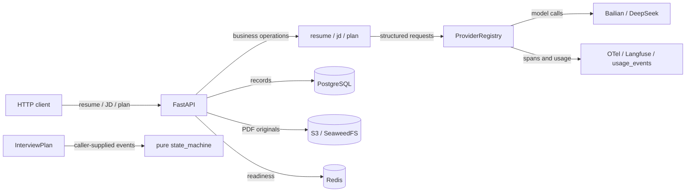
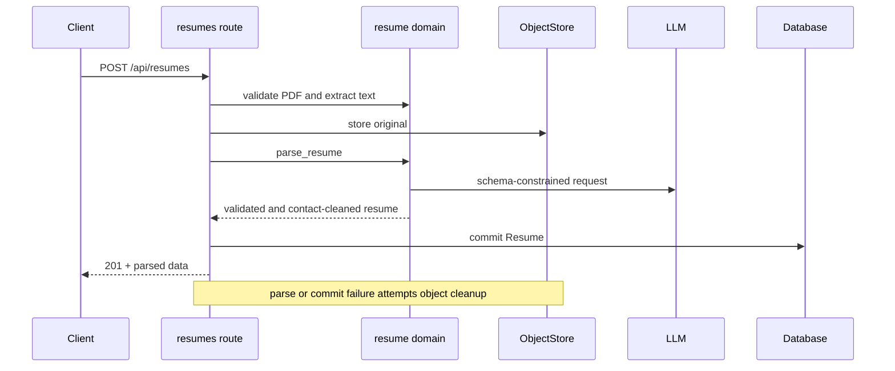
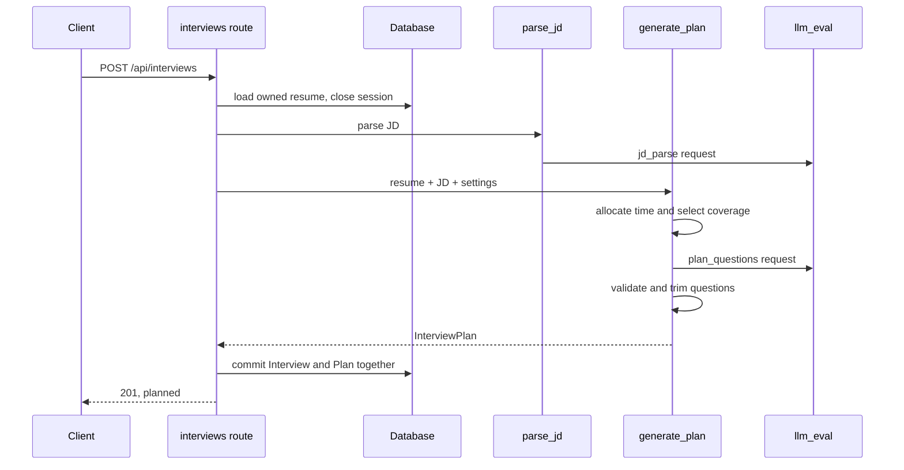
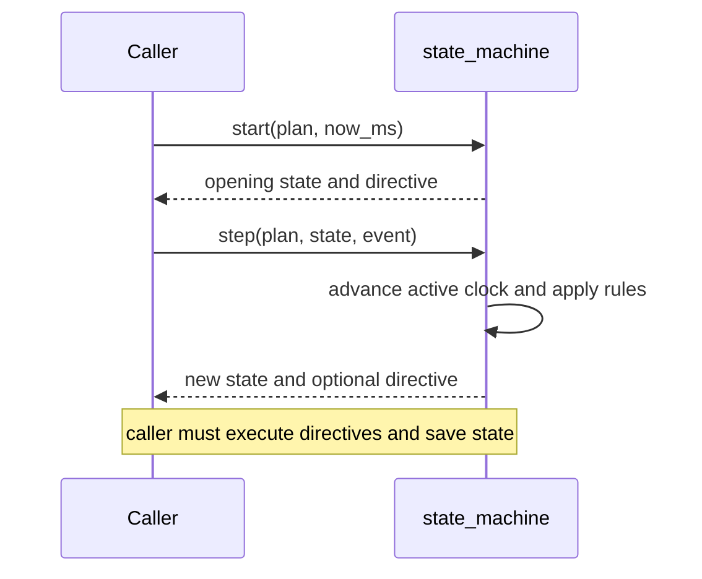

# What the repository implements today

[中文](01-overview.zh-CN.md)

Reviewed on 2026-10-18 against `main`, commit `14c2844`. This describes the primary checkout. Requirements, planned work and other local worktrees are not counted as implemented features.

## Present capability

The repository has a working backend path for preparing an interview: upload and parse a resume, extract weighted competencies from a job description, generate an interview plan, then inspect or edit it. A pure interview state machine and substantial provider, storage, telemetry and deployment infrastructure also exist. The system cannot yet conduct a complete text or voice interview or produce an assessment report.

| Area | Implemented | Boundary |
|---|---|---|
| Resume | PDF validation, extraction, structured parsing, S3 original, read/edit API | 10 MiB maximum; no OCR |
| Job description | Title, inferred level, 3–6 weighted competencies, probes, terminology | Preview does not persist; interview creation reparses the text |
| Plan | Technical/behavioral, gentle/pressure, language input, 15/20/30 minutes | These options affect planning; full conversation modes do not exist yet |
| Plan editing | Edit question text, key points and proposed follow-ups; delete questions | No new IDs or changes to stage/competency/project; coverage remains mandatory |
| State machine | Stages, questions, follow-ups, pause/resume, repeat/skip/end, deadlines | No API integration or runtime persistence caller |
| Providers | Bailian/DeepSeek LLM, streaming ASR, hotwords, two TTS protocols, fakes | Voice components are not wired to a LiveKit worker |
| Infrastructure | Database, S3, usage/cost, telemetry, configuration, CI and deployment scripts | Scripts are not proof that deployed services are currently healthy |

## Architecture

The application factory is [app.py:42](../../backend/src/interview/api/app.py#L42). It mounts three business routers: resumes, JD and interviews. Redis is initialized and checked for readiness; there is no implemented interview queue or recovery workflow. The state machine is deliberately shown separately because no current API route invokes it.

## Trace 1: resume upload

Follow [create_resume:107](../../backend/src/interview/api/routes/resumes.py#L107) → [check_resume_file:188](../../backend/src/interview/domain/resume.py#L188) → [extract_text:196](../../backend/src/interview/domain/resume.py#L196) → [parse_resume:216](../../backend/src/interview/domain/resume.py#L216) → [generate_structured:123](../../backend/src/interview/prompts/structured.py#L123).

The route checks the actual PDF header and size. pypdf extraction runs in a thread. Image-only scans are rejected rather than OCRed. Storage precedes the model request, avoiding parsing costs when object storage fails. Parsed data includes name, employment, projects, skills and education; email and Chinese mobile-number patterns are removed from those structured fields. The original PDF is retained intact.

Failure after uploading triggers a compensating delete. A failed cleanup is logged, so this is not an atomic transaction spanning the database and object storage. Read/edit operations are scoped to the configured user; replacement requires the complete parsed object.

## Trace 2: interview planning

Follow [create_interview:194](../../backend/src/interview/api/routes/interviews.py#L194) → [_load_resume:124](../../backend/src/interview/api/routes/interviews.py#L124) → [parse_jd:91](../../backend/src/interview/domain/jd.py#L91) → [generate_plan:490](../../backend/src/interview/domain/plan.py#L490) → [_persist:154](../../backend/src/interview/api/routes/interviews.py#L154).

JD input is limited to 10,000 characters. The parser requires 3–6 competencies, normalizes weights to sum to one and cleans/deduplicates terminology, retaining at most 30 terms of at most 20 characters each. The separate `POST /api/jd/parse` endpoint only previews this result.

Stage durations are deterministic code, not model output. A 20-minute technical interview allocates 1/2/6/8/2/1 minutes to opening, introduction, resume deep dive, technical questions, candidate questions and closing. Other supported durations scale that allocation; behavioral interviews replace the technical stage. Question capacity assumes 180 seconds per question.

The generator prioritizes competencies by weight when capacity is insufficient and marks the rest `covered=False`. Selected competencies must have questions. Each competency has at most two questions; deep dives must reference actual resume projects or employers. Excess generated questions are trimmed and coverage is rechecked, with invalid structured output fed back for retry.

The initial read session closes before model calls. Interview and Plan are committed together with status `planned`. Structured generation failure returns 502 without writing those business records; provider usage can still have incurred cost.

[update_plan:261](../../backend/src/interview/api/routes/interviews.py#L261) replaces the question list while preserving stored IDs and stage/competency/project associations. Deletions must preserve required coverage. Editing a non-planned interview returns 409.

## Trace 3: state transitions

[start:393](../../backend/src/interview/domain/state_machine.py#L393) initializes the interview; [step:405](../../backend/src/interview/domain/state_machine.py#L405) handles `Decision`, `Command`, `Tick` and `Think`. Stages progress from opening through closing to ended.

Defaults allow two follow-ups per question, stop active time during pauses, issue a check-in after 20 seconds of thinking, and apply stage/total deadlines with a 30-second grace period. Repeat reissues the previous directive; skip advances a question or stage; end enters closing. State is serializable, but no runtime persistence integration exists.

The module decides what should happen. It does not interpret speech, evaluate an answer, call an LLM, synthesize audio, schedule ticks or save turns. A caller must supply evaluator decisions; that evaluator has not been implemented. Tests include complete progression and Hypothesis checks over random event sequences.

## Shared infrastructure and constraints

[ProviderRegistry:170](../../backend/src/interview/providers/registry.py#L170) creates role-specific adapters lazily, reuses connections and attaches call context. Bailian and DeepSeek support LLM calls; a fallback handles selected recoverable errors. Streaming failover only occurs before any output has been emitted.

[generate_structured:123](../../backend/src/interview/prompts/structured.py#L123) supplies a JSON Schema and validates with Pydantic. The default allows two retries, or three total attempts. Retry usage is recorded. Prompts have version/content-hash locks. Provider transport errors are handled outside structured-validation retries.

[Observer:93](../../backend/src/interview/providers/observed.py#L93) captures spans and usage: tokens, audio seconds, synthesis characters and estimated CNY cost. [Budget checking:97](../../backend/src/interview/observability/budget.py#L97) returns per-interview and Beijing-calendar-day signals: warn at 80%, exceeded at the limit. No current interview orchestration invokes automatic model downgrade, wrap-up or request blocking.

Nine tables exist: users, resumes, interviews, plans, turns, evaluations, reports, turn_metrics and usage_events. Schema readiness for turns, assessments, reports and voice timing is not evidence that their product workflows exist. [scope.py](../../backend/src/interview/db/scope.py) filters owned ORM operations and validates writes, with documented raw-SQL limitations. Requests use a configured local default user; login/authentication is absent.

Deployment tooling covers VPS Postgres, Redis, SeaweedFS and Prometheus/Grafana; SSH tunnels; native local LiveKit; and local Docker Langfuse. Benchmarking, audio conversion, hotword management and a cost-report command are available.

## Remaining product work

Current implementation corresponds to PR-16 in the development plan. Answer evaluation/evidence validation, interviewer utterances, orchestration, text WebSocket and reports from PR-17–21 are absent. There is no `web/` app. `voice/` contains only its initialization file: no LiveKit Agents dependency, STT/TTS plugins, worker, turn detection, barge-in pipeline or interview recording.

[ADR-0002](../adr/0002-split-eval-roles.md) still proposes separate real-time and final-report model roles; that split has not landed. Existing [benchmark findings](../benchmarks/findings.md) document prior provider experiments, not a completed product-level voice test. Small ASR samples, intermittent synthesis stalls and latency budget gaps remain explicitly unresolved there.

One documentation mismatch matters for local demos: setting `LLM_EVAL_PROVIDER=fake` selects a default [text-echo FakeLLM](../../backend/src/interview/providers/fake.py#L31), not a schema-aware resume/JD/plan simulator. Tests inject scripted responses to exercise those flows. Changing the provider flag alone does not guarantee successful structured parsing.

## Change map

| Goal | Start here | Preserve |
|---|---|---|
| Change planning | `domain/plan.py`, `prompts/plan_questions.md`, `test_plan.py` | Capacity, coverage, real project references, prompt versions and lock |
| Change interview progression | `domain/state_machine.py`, `test_state_machine.py` | Pause accounting, monotonic time, terminal behavior, follow-up cap |
| Enable a complete text interview | Add evaluator/interviewer/orchestrator, then API integration | Execute directives, save turns/state, handle timeouts and budgets |
| Add a provider | `providers/`, registry, configuration and `.env.example` | Streaming/cancellation semantics, usage accounting and telemetry |

This table identifies likely edit surfaces from the code; it does not add product requirements or attribute undocumented design intent.

## Verification

Ran `UV_CACHE_DIR=/private/tmp/interview-agent-uv-cache UV_OFFLINE=1 make check`: formatting and ruff passed, pyright reported zero errors/warnings, and pytest reported **461 passed, 23 deselected**. The first sandboxed run failed 43 localhost-binding tests; the same checks passed when local port binding was permitted.

Live provider tests and PostgreSQL integration tests are excluded by default and were not run. This review did not start or validate the VPS deployment or a real voice call. API flows are exercised with SQLite and injected fake model responses; that is distinct from real-provider end-to-end verification.

Local document links were checked. Mermaid blocks passed the export script's structural checks, which are not full syntax parsing. PNG export was unavailable because mermaid-cli was not cached in the offline environment; editable Mermaid source is retained.
