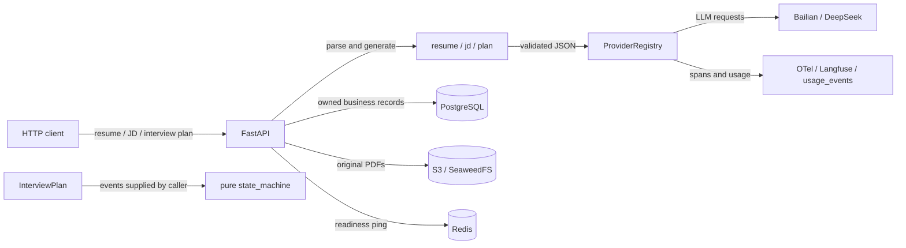
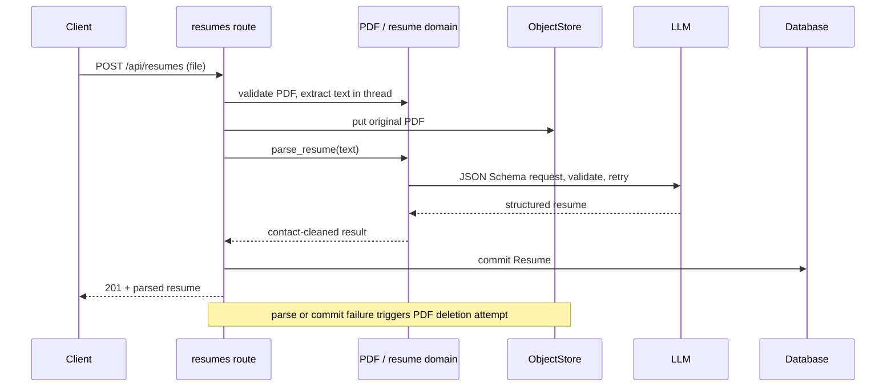
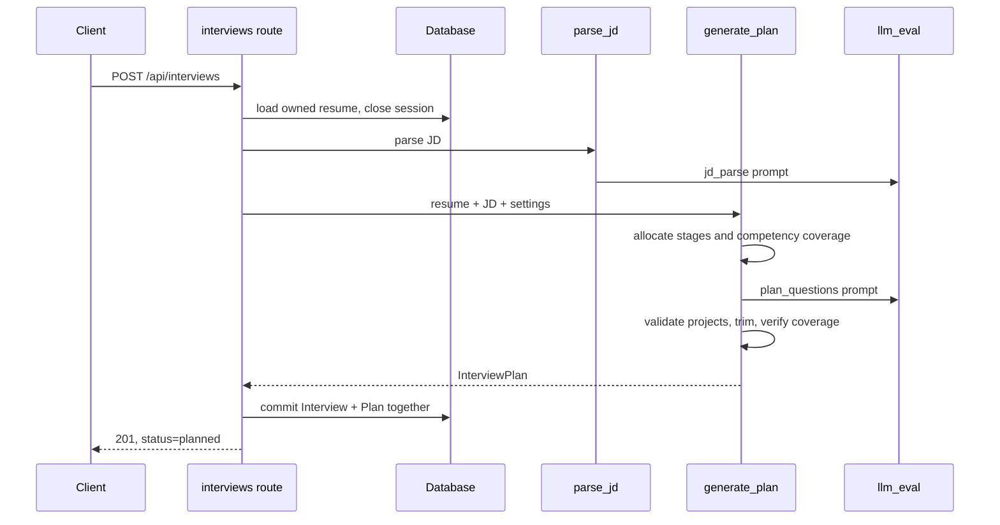
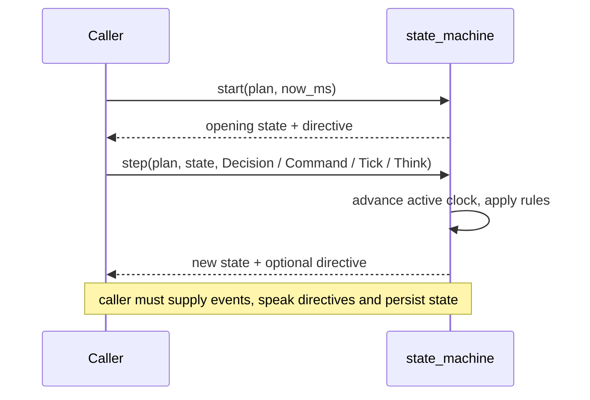

# 当前仓库实现分析

[English](01-overview.md)

分析日期：2026-10-18。代码基线：`main`，`14c2844`。本文描述当前主工作区的实现，不把 PRD、开发计划和本地其他 worktree 中的代码算作已完成能力。

## 当前能做什么

这是一个语音模拟面试产品的开发中后端。目前接通了“上传简历 → 解析 JD → 按岗位生成面试计划 → 查看和修改计划”，同时实现了独立的面试状态机、模型及语音厂商适配、成本记录和可观测性。完整的文字面试、浏览器界面、实时语音面试和评分报告尚未接通。

| 能力 | 当前实现 | 边界 |
|---|---|---|
| PDF 简历 | 校验、抽取文字、结构化解析、原件存储、查看和修改 | 最大 10 MiB；无 OCR，扫描件没有文字层时拒绝 |
| JD 解析 | 岗位/级别、3–6 个能力项、归一化权重、考察点、技术术语 | 单独解析接口只做预览；创建面试时重新解析 |
| 面试计划 | 技术面/行为面、温和/压力风格、语言参数、15/20/30 分钟 | 语言和风格参与出题，不代表完整语言模式和对话已完成 |
| 计划修改 | 修改题干、要点、2–3 条候选追问，允许删除题目 | 不允许新增题目、改阶段或能力项；删除后仍须覆盖选中能力项 |
| 状态机 | 阶段、换题、追问、暂停/恢复、重复/跳过/结束、超时 | 纯逻辑模块，API 尚未调用它；也没有运行时状态持久化链路 |
| LLM | 百炼与 DeepSeek、流式/非流式、超时与备用切换 | 已输出流式片段后出错不会切备用重播 |
| ASR/TTS | 百炼流式识别、热词、两种合成协议、连接管理及取消 | 组件层实现；`voice/` 只有初始化文件，没有 LiveKit worker |
| 工程设施 | 配置、日志、OTel、Langfuse、Prometheus、成本、数据库、S3、CI | 部署脚本存在不等于本次已验证所有外部服务在线 |

## 运行结构

API 入口在 [app.py:42](../../backend/src/interview/api/app.py#L42)。当前只挂载 resumes、jd、interviews 三组业务路由。Redis 被创建并用于就绪检查；没有证据表明已经用它实现面试队列或断线恢复。状态机是独立组件，图中没有从 API 指向它的边。

## 路径一：上传简历

调用链：[create_resume:107](../../backend/src/interview/api/routes/resumes.py#L107) → [check_resume_file:188](../../backend/src/interview/domain/resume.py#L188) → [extract_text:196](../../backend/src/interview/domain/resume.py#L196) → [parse_resume:216](../../backend/src/interview/domain/resume.py#L216) → [generate_structured:123](../../backend/src/interview/prompts/structured.py#L123)。

文字抽取使用 pypdf，放到线程中执行以避免阻塞事件循环。原件先存 S3，存储失败就不会调用模型。结果包含姓名、工作经历、项目、技能、教育，清理邮箱和中国手机号；原始 PDF 本身仍然保留完整内容。这不是对原件的脱敏。

解析或入库失败时，路由尝试删除刚上传的原件；删除失败记日志。因此这是补偿清理，不是数据库和对象存储之间的原子事务。GET/PATCH 只访问当前用户的简历；PATCH 需要提交完整解析结果。

## 路径二：创建及修改面试计划

调用链：[create_interview:194](../../backend/src/interview/api/routes/interviews.py#L194) → [_load_resume:124](../../backend/src/interview/api/routes/interviews.py#L124) → [parse_jd:91](../../backend/src/interview/domain/jd.py#L91) → [generate_plan:490](../../backend/src/interview/domain/plan.py#L490) → [_persist:154](../../backend/src/interview/api/routes/interviews.py#L154)。

JD 最长 10,000 字符，输出 3–6 个能力项；权重被归一化为和为 1，术语去重、清理空白，最多 30 个、每个最多 20 字符。独立入口为 `POST /api/jd/parse`，该入口不会保存 JD。

时间由代码分配而非模型决定。20 分钟技术面的阶段为：开场 1 分钟、自我介绍 2 分钟、简历深挖 6 分钟、技术考察 8 分钟、候选人提问 2 分钟、收尾 1 分钟。15/30 分钟按比例缩放；行为面替换技术考察阶段。题量按每题 180 秒估算。

题量不足以覆盖所有能力时，优先选高权重能力，并把其他能力标记为 `covered=False`。已选择的能力必须有题；每个能力最多两题；深挖题必须指向简历中实际存在的项目或公司。生成超量题目时会裁剪，校验后仍无法覆盖则要求模型重试。

模型调用期间不会保持前面读取简历的数据库会话。最终 Interview 和 Plan 同事务写入，状态为 `planned`；结构化生成失败返回 502，不写这两张业务记录，但模型调用可能已产生费用。

修改入口为 [update_plan:261](../../backend/src/interview/api/routes/interviews.py#L261)。它整份替换题目列表，保留原 ID、阶段、能力项、项目关联；删题不得破坏覆盖。非 `planned` 状态返回 409。

## 路径三：推进状态机

入口：[start:393](../../backend/src/interview/domain/state_machine.py#L393)、[step:405](../../backend/src/interview/domain/state_machine.py#L405)。状态沿开场、自我介绍、简历深挖、技术/行为考察、候选人提问、收尾、结束推进。

默认每题最多追问两次；暂停停止有效计时；思考等待 20 秒后输出 `check_in` 指令；阶段和总时间有超时处理以及 30 秒宽限。`repeat` 重发上一条指令；`skip` 换题或换阶段；`end` 进入收尾。状态可序列化，但持久化调用方尚不存在。

这是“决定下一步做什么”的引擎，不会自己识别用户原话、调用模型、合成语音、启动定时器或保存问答。`Decision` 目前需要调用方提供；后台评估器尚未实现。测试包含完整阶段推进和 Hypothesis 随机事件不变量检查。

## 贯穿这些流程的基础能力

模型通过 [ProviderRegistry:170](../../backend/src/interview/providers/registry.py#L170) 获取，前台/评估/备用角色可配置。适配器按角色惰性创建、复用；每次调用绑定 user/interview/turn 和用途标签。备用切换覆盖部分可恢复厂商错误；流式已经输出内容后不会重新切换并重复输出。

[generate_structured:123](../../backend/src/interview/prompts/structured.py#L123) 注入 JSON Schema，解析结果用 Pydantic 校验，默认失败最多重试两次（共三次尝试），重试计费。提示词有版本与内容哈希锁，启动和测试会检查。厂商错误由适配器及备用机制处理，不是结构化重试的范围。

[Observer:93](../../backend/src/interview/providers/observed.py#L93) 记录调用链和用量；计量包含 token、音频秒数、合成字符数及估算人民币成本。[预算检查:97](../../backend/src/interview/observability/budget.py#L97) 返回单场和北京时间每日预算信号，80% 为 warn、达到上限为 exceeded。当前尚未接入自动换便宜模型、收尾或禁止继续调用，不能当作已生效的调用拦截器。

数据库已有 users、resumes、interviews、plans、turns、evaluations、reports、turn_metrics、usage_events 九张表及迁移。后四类面试数据的表结构存在，不代表问答、评分、报告、语音指标业务已经完成。ORM 的用户过滤与写入归属检查在 [scope.py](../../backend/src/interview/db/scope.py)，并不覆盖所有原生 SQL。API 使用配置中的单一本地用户，尚无登录认证。

部署脚本支持 VPS 上的 Postgres、Redis、SeaweedFS、Prometheus/Grafana，本机 SSH 隧道、LiveKit 原生服务和 Docker Langfuse。厂商基准测试工具、录音转换、热词工具、成本报告命令均已存在。

## 尚未完成的产品闭环

开发计划当前对应到 PR-16。后续 PR-17–21 的回答评估与证据校验、前台面试官、编排、文字 WebSocket、报告生成都还没有实际模块。`web/` 尚不存在；LiveKit Agents 依赖、STT/TTS 插件、worker、轮次判定、用户打断处理、双方录音也尚未实现。不能通过浏览器完成整场面试。

[ADR-0002](../adr/0002-split-eval-roles.md) 仍为“提议”，实时评估与最终报告模型角色拆分尚未落地。仓库里的厂商实测报告可用于了解已有实验，但不是当前产品端到端验收：见 [实测结论](../benchmarks/findings.md)。其中记录的识别样本不足、合成偶发卡顿和延迟超预算仍需后续验证。

README 说 `LLM_EVAL_PROVIDER=fake` 可做接口联调；但默认 [FakeLLM](../../backend/src/interview/providers/fake.py#L31) 是文本回显，不会自动生成合法简历/JD/计划 JSON。测试中通过注入专用回复脚本才完成结构化流程；单改 provider 配置不能保证这条流程成功。

## 从哪里改起

| 改动目标 | 主要入口 | 需要守住的约束 |
|---|---|---|
| 出题规则与时长 | `domain/plan.py`、`prompts/plan_questions.md`、`test_plan.py` | 权重覆盖、阶段容量、项目真实性；改提示词需升版并更新 lock |
| 面试推进规则 | `domain/state_machine.py`、`test_state_machine.py` | 暂停计时、时间单调、终态、追问上限；未来调用方要持久化新状态 |
| 开始完整文字面试 | 新评估器/面试官/编排模块，接状态机，再接 API | 指令执行、问答保存、超时降级、预算处理目前都需要补齐 |
| 替换厂商 | `providers/`、`registry.py`、`config.py`、`.env.example` | 接口兼容、流式中断语义、计费用量、可观测性 |

以上是从现有代码得到的改动面建议，不是新增的产品需求。

## 本次验证

执行 `UV_CACHE_DIR=/private/tmp/interview-agent-uv-cache UV_OFFLINE=1 make check`：格式检查通过、ruff 通过、pyright 为 0 errors / 0 warnings、pytest **461 passed，23 deselected**。沙箱内首次测试有 43 项因不能绑定 localhost 端口失败；允许本地端口后的同一检查全部通过。

默认排除真实厂商 live 测试和 PostgreSQL 集成测试。本次没有运行它们，没有启动或验证 VPS、完整外部依赖部署及真实语音通话。API 主路径有 SQLite + 注入假模型的测试验证；不把这一点等同于真实厂商端到端验收。

文档本地链接已检查，Mermaid 图通过了导出脚本的结构检查（并非完整语法解析）。PNG 导出因离线环境中没有缓存 mermaid-cli 而未完成，保留可编辑的 Mermaid 源码。
